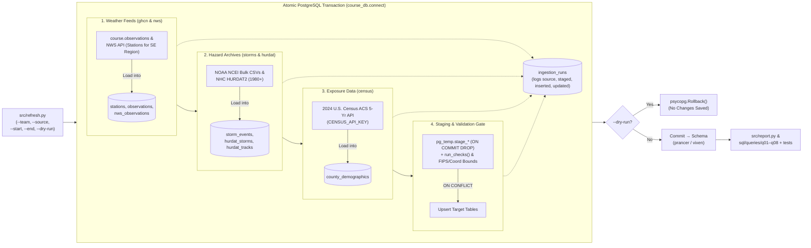
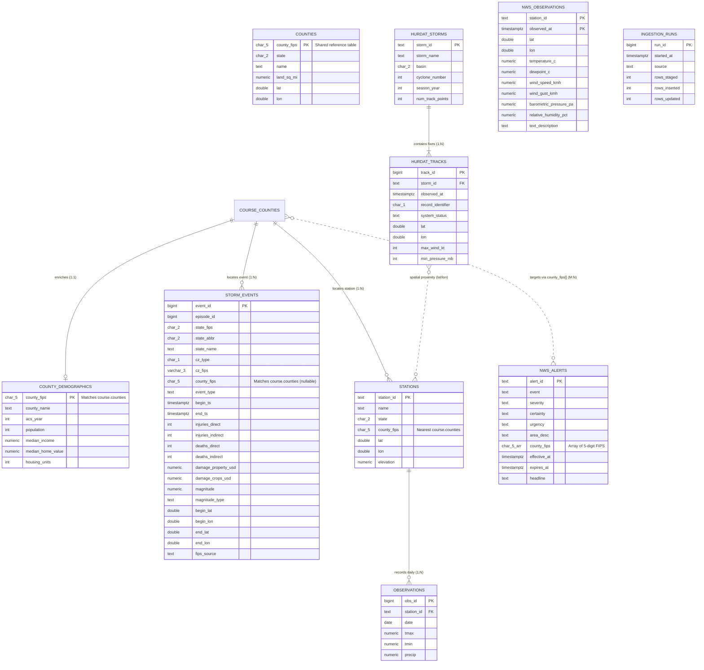

# Climate Risk Analytics & P&C Insurance Underwriting — Technical Specification
## Document header
| Attribute | Value |
|---|---|
| Document name | `TS_Climate_Risk_Analytics_Prancer` |
| Authors | Ainika Hou; Matthew Mellors; Bruck Setu |
| Created on | November 17, 2026 |
| Repository | https://github.com/mrmellors/climate-etl-prancer |
| Knowledge transfer | [docs/kt-log.md](https://github.com/mrmellors/climate-etl-prancer/blob/main/docs/kt-log.md) |
## Sign-offs
| Approval | Approver | Date |
|---|---|---|
| Development |  |  |
| Management |  |  |
| Business |  |  |
## Revision history
| Author | Reason for revision | Version | Date | Reference |
|---|---|---|---|---|
| Team Prancer | Initial authoring | 1.0 | 2026-11-17 | `9dec153` (initial release baseline) |
| Team Prancer | Updated refresh modules, eight query/test pairs, and technical documentation | 1.1 | 2026-11-20 | `main` (verify latest commit before submitting) |
## Objects list
| Object | Type | Purpose |
|---|---|---|
| `sql/schema.sql` | SQL | Creates team tables, keys, checks, and indexes |
| `src/refresh.py` | Python | Source selection and dispatch (`--source`) |
| `src/refresh_ghcn.py` | Python | GHCN station metadata and daily observation refresh |
| `src/refresh_storms.py` | Python | NOAA Storm Events ingestion |
| `src/refresh_hurricanes.py` | Python | HURDAT2 storms and track fixes |
| `src/refresh_nws.py` | Python | NWS station observations |
| `src/refresh_nws_alerts.py` | Python | NWS alerts |
| `src/refresh_census.py` | Python | ACS county estimates |
| `src/load_states.py` | Python | Reference-state population |
| `src/report.py` | Python | Parameterized state-level flood comparison |
| `sql/queries/q01–q08*.sql` | SQL | Eight client analytics queries |
| `sql/tests/t01–t08*.sql` | SQL | Eight query-specific zero-row checks |
| `docs/runbook.md` | Markdown | Operational troubleshooting and recovery |
| `ai/AI-LOG.md` | Markdown | AI use and verification |
| `reports/report.qmd` | Quarto | Reporting artifact |
## High-level technical overview
Team Prancer operates a PostgreSQL climate-risk warehouse in the `prancer` schema, combining NOAA Storm Events, NHC HURDAT2 cyclone paths, GHCN daily weather data, NWS observations and alerts, and Census ACS county demographics. Source-specific Python programs fetch and normalize records, load temporary staging tables, validate keys and values, and merge records using conflict-aware inserts. Most source programs log completed ingestion counts to `ingestion_runs`. Eight SQL queries support risk underwriting decisions about floods, hail seasons, major loss episodes, fatalities, county exposure, and hurricane proximity. A parameterized flood comparison is also implemented in `src/report.py`.
**Analytical region:** Texas (48), Louisiana (22), Florida (12), Georgia (13), South Carolina (45), and North Carolina (37). Several source loaders include Alabama (01) and Virginia (51), so the stored geographic coverage may be broader than the six-state query focus. **Historical scope:** NOAA Storm Events from 1996 onward, HURDAT2 tracks from 1980 onward, current/recent GHCN and NWS observations, and 2024 ACS five-year county indicators. **Not included:** proprietary insured claims, Zillow ZHVI data, and xView2 satellite labeling. NOAA dollar estimates are nominal and should not be interpreted as inflation-adjusted insurance payouts.
## Process flow diagram

## ER diagram

## Assumptions
- Operators authenticate to `mads_f26` through CMU Entra using the course-provided `course_db` helper; no secrets are checked into Git.
- All client geographic comparisons use the six target states even when staging or source feeds have a larger footprint.
- The top-level `src/refresh.py` accepts `--source` only; each source module manages its own database connection and transaction.
- Missing or unmatched county FIPS values cannot be used for county-level demographic joins.
- A hurricane track point close to a station does not establish simultaneous station observations.
- Source publication schedules and API availability vary; refreshes are manually invoked unless an external scheduler is configured.
- Dry-run behavior and shared atomic transactions shown in the preserved process diagram describe an earlier workflow; the latest dispatcher does not expose `--dry-run`.
## Dependencies
| Dependency | Access/update pattern | Objects |
|---|---|---|
| NOAA NCEI Storm Events | Public annual CSV files; refreshed as new monthly releases appear | storm_events |
| NHC HURDAT2 | Public Atlantic best-track archive; seasonal revisions | hurdat_storms, hurdat_tracks |
| NOAA GHCN-Daily | Station list, inventory, daily observations; daily updates | stations, observations |
| NWS API | Observations and alerts; frequent updates; HTTP User-Agent | nws_observations, nws_alerts |
| Census ACS 5-Year | 2024 county estimates; API key from environment; annual updates | county_demographics |
| course.counties | CMU server geographic reference | counties and county-FIPS checks |
| CMU PostgreSQL / course_db | `prancer_write` role; Entra login | all tables |
| Python 3.13 / requirements.txt | psycopg, azure-identity, pandas, requests, visualization and notebook packages | ETL / report |
## Roles and authorizations
| Role/person | Responsibility / access |
|---|---|
| `prancer_write` | Team schema DDL and ETL writes under CMU authorization |
| Team Prancer | Build, validation, documentation, and original design explanation |
| Team Vixen | Receiver operation after November 23 knowledge transfer, subject to course-granted access |
| Ainika Hou | Schema and core ETL work |
| Matthew Mellors | Storm Events and HURDAT2 development |
| Bruck Setu | Eight client queries and corresponding tests; team integration |
## Design decisions
- **Separate source modules.** `src/refresh.py` dispatches into six source-specific refresh programs so each feed can be run and debugged separately; source modules maintain their own transaction boundaries rather than one all-source transaction.
- **Stable row units and keys.** NOAA uses `event_id`; hurricanes use a storm header and uniquely identified fixes; GHCN uses `(station_id, date)`; NWS observations use `(station_id, observed_at)`. Conflict-aware merges make reruns safe.
- **County FIPS as enrichment bridge.** `county_fips` connects storm events and stations to Census county information; invalid or unmatched county codes are not forced into misleading joins.
- **Six-state client analysis.** Underwriting queries filter to the six required coastal states; retained loader coverage can include Alabama and Virginia to support extra regional observations.
- **Retain both frequency and severity measures.** SQL outputs expose counts, sums, and averages, since total property damage by itself cannot distinguish more storms from more severe losses.
## Known issues and limitations
- The two diagrams above were supplied as final artifacts and are intentionally preserved without changes. Some labels in the process diagram describe an earlier `--team`, `--start`, `--end`, `--dry-run` interface and a single global transaction; the latest `src/refresh.py` accepts `--source` and invokes independently transactional modules.
- The supplied ER diagram includes some columns not present in the latest `sql/schema.sql` (e.g. `storm_events.state_abbr` and `storm_events.state_name`); the field listings below reflect the latest code/schema.
- `county_demographics` in the latest schema does not contain an `acs_year` column; a client query that filters `d.acs_year` should be checked against the deployed schema and revised if needed.
- Some ETL modules select eight states whereas the client queries select six; this is an intentional analytical filter but does not mean all stored rows are limited to six states.
- Storm loss amounts are NOAA estimates in nominal dollars and do not prove systematic underreporting; billion-dollar episodes are not equivalent to NOAA’s official adjusted disaster events.
- Not all validation scripts provide zero-row results: some earlier `t00` scripts were written as procedural or schema-inspection checks.
- The `reports/report.qmd` visuals are a separate reporting deliverable and should not be represented as validated solely from client SQL query success.
---
## Database table specifications
### Database table: `prancer.states`
**Description:** State/territory reference. **Row unit:** One state, territory, or district. **Primary key:** `state_fips`. **Source:** State FIPS lookup.
| Field | Description | Data source | Data type | Key | Units |
|---|---|---|---|---|---|
| `state_fips` | Two-digit state FIPS identifier | State FIPS lookup | `CHAR(2)` | PK | — |
| `state_abbr` | State abbr | State FIPS lookup | `CHAR(2)` |  | — |
| `state_name` | State name | State FIPS lookup | `TEXT` |  | — |
**Validation / relationships:** Type/key checks and identifier and nonnegative counter constraints in `sql/schema.sql`.
### Database table: `prancer.counties`
**Description:** County geographic reference copied from course.counties. **Row unit:** One county. **Primary key:** `county_fips`. **Source:** course.counties.
| Field | Description | Data source | Data type | Key | Units |
|---|---|---|---|---|---|
| `county_fips` | Five-digit county FIPS identifier | course.counties | `CHAR(5)` | PK | — |
| `state` | State | course.counties | `CHAR(2)` |  | — |
| `name` | Name | course.counties | `TEXT` |  | — |
| `land_sq_mi` | Land sq mi | course.counties | `DOUBLE PRECISION` |  | square miles |
| `lat` | Lat | course.counties | `DOUBLE PRECISION` |  | degrees |
| `lon` | Lon | course.counties | `DOUBLE PRECISION` |  | degrees |
**Validation / relationships:** Type/key checks and coordinate and nonnegative-value limits as defined in `sql/schema.sql`.
### Database table: `prancer.county_demographics`
**Description:** ACS 5-year county exposure proxies. **Row unit:** One county (latest ACS values). **Primary key:** `county_fips`. **Source:** 2024 Census ACS API.
| Field | Description | Data source | Data type | Key | Units |
|---|---|---|---|---|---|
| `county_fips` | Five-digit county FIPS identifier | 2024 Census ACS API | `CHAR(5)` | PK | — |
| `county_name` | County name | 2024 Census ACS API | `TEXT` |  | — |
| `population` | Population | 2024 Census ACS API | `INTEGER` |  | people |
| `median_income` | Median income | 2024 Census ACS API | `NUMERIC(12, 2)` |  | USD |
| `median_home_value` | Median home value | 2024 Census ACS API | `NUMERIC(14, 2)` |  | USD |
| `housing_units` | Housing units | 2024 Census ACS API | `INTEGER` |  | units |
**Validation / relationships:** Type/key checks and coordinate and nonnegative-value limits as defined in `sql/schema.sql`.
### Database table: `prancer.storm_events`
**Description:** NOAA hazard events with loss, casualty, and location fields. **Row unit:** One NOAA Storm Events record. **Primary key:** `event_id`. **Source:** NOAA NCEI Storm Events CSV.
| Field | Description | Data source | Data type | Key | Units |
|---|---|---|---|---|---|
| `event_id` | Event id | NOAA NCEI Storm Events CSV | `BIGINT` | PK | — |
| `episode_id` | NOAA storm episode identifier | NOAA NCEI Storm Events CSV | `BIGINT` |  | — |
| `state_fips` | Two-digit state FIPS identifier | NOAA NCEI Storm Events CSV | `CHAR(2)` | FK | — |
| `cz_type` | County (C), zone (Z), marine (M) record type | NOAA NCEI Storm Events CSV | `CHAR(1)` |  | — |
| `cz_fips` | Cz fips | NOAA NCEI Storm Events CSV | `VARCHAR(3)` |  | — |
| `cz_name` | Cz name | NOAA NCEI Storm Events CSV | `TEXT` |  | — |
| `cz_timezone` | Cz timezone | NOAA NCEI Storm Events CSV | `TEXT` |  | — |
| `county_fips` | Five-digit county FIPS identifier | NOAA NCEI Storm Events CSV | `CHAR(5)` |  | — |
| `event_type` | NOAA hazard classification | NOAA NCEI Storm Events CSV | `TEXT` |  | — |
| `begin_ts` | Event start in UTC | NOAA NCEI Storm Events CSV | `TIMESTAMPTZ` |  | — |
| `end_ts` | Event end in UTC | NOAA NCEI Storm Events CSV | `TIMESTAMPTZ` |  | — |
| `injuries_direct` | Injuries direct | NOAA NCEI Storm Events CSV | `INTEGER` |  | — |
| `injuries_indirect` | Injuries indirect | NOAA NCEI Storm Events CSV | `INTEGER` |  | — |
| `deaths_direct` | Deaths direct | NOAA NCEI Storm Events CSV | `INTEGER` |  | — |
| `deaths_indirect` | Deaths indirect | NOAA NCEI Storm Events CSV | `INTEGER` |  | — |
| `damage_property_usd` | Damage property usd | NOAA NCEI Storm Events CSV | `NUMERIC(16, 2)` |  | USD |
| `damage_crops_usd` | Damage crops usd | NOAA NCEI Storm Events CSV | `NUMERIC(16, 2)` |  | USD |
| `magnitude` | Magnitude | NOAA NCEI Storm Events CSV | `NUMERIC` |  | — |
| `magnitude_type` | Magnitude type | NOAA NCEI Storm Events CSV | `TEXT` |  | — |
| `begin_lat` | Begin lat | NOAA NCEI Storm Events CSV | `DOUBLE PRECISION` |  | degrees |
| `begin_lon` | Begin lon | NOAA NCEI Storm Events CSV | `DOUBLE PRECISION` |  | degrees |
| `end_lat` | End lat | NOAA NCEI Storm Events CSV | `DOUBLE PRECISION` |  | degrees |
| `end_lon` | End lon | NOAA NCEI Storm Events CSV | `DOUBLE PRECISION` |  | degrees |
**Validation / relationships:** Primary key and foreign-key checks plus coordinate and nonnegative-value limits as defined in `sql/schema.sql`.
### Database table: `prancer.hurdat_storms`
**Description:** HURDAT2 cyclone header and identifiers. **Row unit:** One tropical cyclone. **Primary key:** `storm_id`. **Source:** NHC HURDAT2.
| Field | Description | Data source | Data type | Key | Units |
|---|---|---|---|---|---|
| `storm_id` | Storm id | NHC HURDAT2 | `TEXT` | PK | — |
| `storm_name` | Storm name | NHC HURDAT2 | `TEXT` |  | — |
| `basin` | Basin | NHC HURDAT2 | `CHAR(2)` |  | — |
| `cyclone_number` | Cyclone number | NHC HURDAT2 | `INTEGER` |  | — |
| `season_year` | Season year | NHC HURDAT2 | `INTEGER` |  | — |
| `num_track_points` | Num track points | NHC HURDAT2 | `INTEGER` |  | — |
**Validation / relationships:** Type/key checks and coordinate and nonnegative-value limits as defined in `sql/schema.sql`.
### Database table: `prancer.hurdat_tracks`
**Description:** HURDAT2 location, intensity and pressure fixes. **Row unit:** One storm/observation-time/record-identifier fix. **Primary key:** `track_id`. **Source:** NHC HURDAT2.
| Field | Description | Data source | Data type | Key | Units |
|---|---|---|---|---|---|
| `track_id` | Track id | NHC HURDAT2 | `BIGINT` | PK | — |
| `storm_id` | Storm id | NHC HURDAT2 | `TEXT` | FK | — |
| `observed_at` | Observation timestamp in UTC | NHC HURDAT2 | `TIMESTAMPTZ` |  | — |
| `record_identifier` | HURDAT fix indicator | NHC HURDAT2 | `CHAR(1)` |  | — |
| `system_status` | HURDAT intensity/status code | NHC HURDAT2 | `TEXT` |  | — |
| `lat` | Lat | NHC HURDAT2 | `DOUBLE PRECISION` |  | degrees |
| `lon` | Lon | NHC HURDAT2 | `DOUBLE PRECISION` |  | degrees |
| `max_wind_kt` | Max wind kt | NHC HURDAT2 | `INTEGER` |  | knots |
| `min_pressure_mb` | Min pressure mb | NHC HURDAT2 | `INTEGER` |  | mb |
**Validation / relationships:** Primary key and foreign-key checks plus coordinate and nonnegative-value limits as defined in `sql/schema.sql`.
### Database table: `prancer.stations`
**Description:** GHCN station locations and metadata. **Row unit:** One weather station. **Primary key:** `station_id`. **Source:** NOAA GHCN station list.
| Field | Description | Data source | Data type | Key | Units |
|---|---|---|---|---|---|
| `station_id` | Station id | NOAA GHCN station list | `TEXT` | PK | — |
| `name` | Name | NOAA GHCN station list | `TEXT` |  | — |
| `state_fips` | Two-digit state FIPS identifier | NOAA GHCN station list | `CHAR(2)` | FK | — |
| `county_fips` | Five-digit county FIPS identifier | NOAA GHCN station list | `CHAR(5)` |  | — |
| `lat` | Lat | NOAA GHCN station list | `DOUBLE PRECISION` |  | degrees |
| `lon` | Lon | NOAA GHCN station list | `DOUBLE PRECISION` |  | degrees |
| `elevation` | Elevation | NOAA GHCN station list | `NUMERIC(7, 2)` |  | m |
**Validation / relationships:** Primary key and foreign-key checks plus coordinate and nonnegative-value limits as defined in `sql/schema.sql`.
### Database table: `prancer.observations`
**Description:** GHCN daily temperatures and precipitation. **Row unit:** One station on one date. **Primary key:** `obs_id`. **Source:** NOAA GHCN API/annual files.
| Field | Description | Data source | Data type | Key | Units |
|---|---|---|---|---|---|
| `obs_id` | Obs id | NOAA GHCN API/annual files | `BIGINT` | PK | — |
| `station_id` | Station id | NOAA GHCN API/annual files | `TEXT` | FK | — |
| `date` | Date | NOAA GHCN API/annual files | `DATE` |  | — |
| `tmax` | Tmax | NOAA GHCN API/annual files | `NUMERIC` |  | °C |
| `tmin` | Tmin | NOAA GHCN API/annual files | `NUMERIC` |  | °C |
| `precip` | Precip | NOAA GHCN API/annual files | `NUMERIC` |  | mm |
**Validation / relationships:** Primary key and foreign-key checks plus coordinate and nonnegative-value limits as defined in `sql/schema.sql`.
### Database table: `prancer.nws_observations`
**Description:** NWS hourly station weather observations. **Row unit:** One station timestamp. **Primary key:** `station_id`, `observed_at`. **Source:** NWS API.
| Field | Description | Data source | Data type | Key | Units |
|---|---|---|---|---|---|
| `station_id` | Station id | NWS API | `TEXT` | PK (composite) | — |
| `observed_at` | Observation timestamp in UTC | NWS API | `TIMESTAMPTZ` | PK (composite) | — |
| `lat` | Lat | NWS API | `DOUBLE PRECISION` |  | degrees |
| `lon` | Lon | NWS API | `DOUBLE PRECISION` |  | degrees |
| `temperature_c` | Temperature c | NWS API | `NUMERIC` |  | °C |
| `dewpoint_c` | Dewpoint c | NWS API | `NUMERIC` |  | °C |
| `wind_speed_kmh` | Wind speed kmh | NWS API | `NUMERIC` |  | km/h |
| `wind_gust_kmh` | Wind gust kmh | NWS API | `NUMERIC` |  | km/h |
| `barometric_pressure_pa` | Barometric pressure pa | NWS API | `NUMERIC` |  | Pa |
| `relative_humidity_pct` | Relative humidity pct | NWS API | `NUMERIC` |  | % |
| `text_description` | Text description | NWS API | `TEXT` |  | — |
**Validation / relationships:** Type/key checks and coordinate and nonnegative-value limits as defined in `sql/schema.sql`.
### Database table: `prancer.nws_alerts`
**Description:** NWS county-targeted warnings and alerts. **Row unit:** One NWS alert. **Primary key:** `alert_id`. **Source:** NWS API.
| Field | Description | Data source | Data type | Key | Units |
|---|---|---|---|---|---|
| `alert_id` | Alert id | NWS API | `TEXT` | PK | — |
| `event` | Event | NWS API | `TEXT` |  | — |
| `severity` | Severity | NWS API | `TEXT` |  | — |
| `certainty` | Certainty | NWS API | `TEXT` |  | — |
| `urgency` | Urgency | NWS API | `TEXT` |  | — |
| `area_desc` | Area desc | NWS API | `TEXT` |  | — |
| `county_fips` | Five-digit county FIPS identifier | NWS API | `CHAR(5)[]` |  | — |
| `effective_at` | Effective at | NWS API | `TIMESTAMPTZ` |  | — |
| `expires_at` | Expires at | NWS API | `TIMESTAMPTZ` |  | — |
| `headline` | Headline | NWS API | `TEXT` |  | — |
**Validation / relationships:** Type/key checks and coordinate and nonnegative-value limits as defined in `sql/schema.sql`.
### Database table: `prancer.ingestion_runs`
**Description:** ETL source/version and row-count audit trail. **Row unit:** One logged source refresh. **Primary key:** `run_id`. **Source:** ETL refresh modules.
| Field | Description | Data source | Data type | Key | Units |
|---|---|---|---|---|---|
| `run_id` | Run id | ETL refresh modules | `BIGINT` | PK | — |
| `started_at` | Started at | ETL refresh modules | `TIMESTAMPTZ` |  | — |
| `source` | Source | ETL refresh modules | `TEXT` |  | — |
| `rows_staged` | Rows staged | ETL refresh modules | `INTEGER` |  | — |
| `rows_inserted` | Rows inserted | ETL refresh modules | `INTEGER` |  | — |
| `rows_updated` | Rows updated | ETL refresh modules | `INTEGER` |  | — |
**Validation / relationships:** Type/key checks and identifier and nonnegative counter constraints in `sql/schema.sql`.
## Program specifications
### Program: `src/refresh.py`
| Attribute | Description |
|---|---|
| **Purpose** | Top-level source dispatcher |
| **Program type** | Python extract / transform / load |
| **Input / parameters** | `--source {ghcn,storms,hurricanes,nws,nws_alerts,census,all}` (default `all`) |
| **Outputs** | Prints source start banners and `Refresh complete!`. |
| **Current state** | Implemented in latest uploaded `main` snapshot |
**Pseudocode**
1. Read `--source`
2. Dispatch to one source or all six
3. Individual source modules connect and manage their own ETL transactions.
**Failure behavior:** A source failure interrupts the dispatcher; previously committed source refreshes are not necessarily rolled back.
### Program: `src/refresh_ghcn.py`
| Attribute | Description |
|---|---|
| **Purpose** | GHCN stations and daily observations |
| **Program type** | Python extract / transform / load |
| **Input / parameters** | `refresh_ghcn_api(start_date=None,end_date=None)`; called with defaults from dispatcher |
| **Outputs** | `stations`, `observations`; batch-level counts |
| **Current state** | Implemented in latest uploaded `main` snapshot |
**Pseudocode**
1. Get GHCN station list and inventory
2. Select eligible stations
3. Fetch recent daily observations in station batches
4. Normalize PRCP/TMAX/TMIN
5. Upsert station metadata
6. Stage observations in `stage_ghcn`
7. Merge unique station-date records
8. Show batch counts.
**Failure and recovery:** Source database writes run within their module transaction, and a failure rolls back that transaction. Files already downloaded remain outside database transaction control.
### Program: `src/refresh_storms.py`
| Attribute | Description |
|---|---|
| **Purpose** | NOAA Storm Events bulk loader |
| **Program type** | Python extract / transform / load |
| **Input / parameters** | `refresh_storms(start_year=1996,end_year=None,force=False)` |
| **Outputs** | `storm_events`; `ingestion_runs` |
| **Current state** | Implemented in latest uploaded `main` snapshot |
**Pseudocode**
1. Enumerate current annual NOAA CSV files
2. Skip recorded versions unless forced
3. Parse dates, loss amounts and county/state FIPS
4. Stage in `stage_storms`
5. Reject missing/duplicate event IDs and invalid timestamps
6. Upsert by `event_id`
7. Log source filename and row counts.
**Failure and recovery:** Source database writes run within their module transaction, and a failure rolls back that transaction. Files already downloaded remain outside database transaction control.
### Program: `src/refresh_hurricanes.py`
| Attribute | Description |
|---|---|
| **Purpose** | NHC HURDAT2 best tracks |
| **Program type** | Python extract / transform / load |
| **Input / parameters** | `refresh_hurricanes()` |
| **Outputs** | `hurdat_storms`, `hurdat_tracks`, `ingestion_runs` |
| **Current state** | Implemented in latest uploaded `main` snapshot |
**Pseudocode**
1. Fetch latest archive
2. Parse storm headers and track fixes
3. Convert UTC times, directional coordinates and missing-value sentinels
4. Stage both tables
5. Validate storm-to-track counts and coordinate ranges
6. Merge storm headers before tracks
7. Log successful archive.
**Failure and recovery:** Source database writes run within their module transaction, and a failure rolls back that transaction. Files already downloaded remain outside database transaction control.
### Program: `src/refresh_nws.py`
| Attribute | Description |
|---|---|
| **Purpose** | NWS recent hourly observations |
| **Program type** | Python extract / transform / load |
| **Input / parameters** | `refresh_nws()` |
| **Outputs** | `nws_observations`, `ingestion_runs` |
| **Current state** | Implemented in latest uploaded `main` snapshot |
**Pseudocode**
1. Get regional ASOS stations
2. Request recent NWS observations with retries
3. Retain latest observation per station-hour
4. Normalize weather values
5. Stage in `stage_nws`
6. Validate unique keys and value ranges
7. Upsert station-time rows
8. Log counts.
**Failure and recovery:** Source database writes run within their module transaction, and a failure rolls back that transaction. Files already downloaded remain outside database transaction control.
### Program: `src/refresh_nws_alerts.py`
| Attribute | Description |
|---|---|
| **Purpose** | NWS hazard alerts |
| **Program type** | Python extract / transform / load |
| **Input / parameters** | `refresh_nws_alerts()` |
| **Outputs** | `nws_alerts`, `ingestion_runs` |
| **Current state** | Implemented in latest uploaded `main` snapshot |
**Pseudocode**
1. Request recent alerts by selected states using pagination/retries
2. Extract identifiers, timing, headline and SAME county codes
3. Deduplicate alert IDs
4. Stage in `stage_nws_alerts`
5. Validate expiration, key and county codes
6. Upsert alerts
7. Log counts.
**Failure and recovery:** Source database writes run within their module transaction, and a failure rolls back that transaction. Files already downloaded remain outside database transaction control.
### Program: `src/refresh_census.py`
| Attribute | Description |
|---|---|
| **Purpose** | ACS five-year demographic data |
| **Program type** | Python extract / transform / load |
| **Input / parameters** | `refresh_census(acs_year=2024)` |
| **Outputs** | `county_demographics`, `ingestion_runs` |
| **Current state** | Implemented in latest uploaded `main` snapshot |
**Pseudocode**
1. Request ACS county indicators using `CENSUS_API_KEY`
2. Filter configured states
3. Convert missing or negative special values to NULL
4. Build five-digit FIPS
5. Stage in `stage_census`
6. Validate geographic keys and values
7. Upsert newer county data
8. Log counts.
**Failure and recovery:** Source database writes run within their module transaction, and a failure rolls back that transaction. Files already downloaded remain outside database transaction control.
### Program: `src/report.py`
| Attribute | Description |
|---|---|
| **Purpose** | Parameterized state-level flood trend comparison |
| **Program type** | Python reporting command |
| **Input / parameters** | `--team`, `--state`, `--baseline-start`, `--baseline-end`, `--recent-start`, `--recent-end`, `--limit` |
| **Outputs** | ASCII summary with frequency, average damage, change and principal driver |
| **Current state** | Implemented in latest uploaded `main` snapshot |
**Pseudocode**
1. Parse state abbreviation or FIPS and comparison windows
2. Validate date order
3. Execute parameterized CTE using `storm_events` joined to `states`
4. Aggregate baseline/recent event counts and property damage
5. Compute frequency and severity indicators
6. Format output table.
**Query safety:** User-selected values are supplied through psycopg parameters, not interpolated into SQL text.
## Query specifications
### Query: `sql/queries/q01-flood-damage-by-year.sql`
**Client question:** How does flood property damage vary by state and year?  
**Row unit:** State × year. **Test:** `sql/tests/t01-flood-damage-by-year.sql`. **Method:** GROUP BY state and year; sum non-null nominal property damage.
| Field | Description | Source |
|---|---|---|
| `state_fips` | Two-digit state FIPS identifier | storm_events |
| `year` | Year | storm_events |
| `flood_events` | Flood events | storm_events |
| `total_damage_usd` | Total damage usd | storm_events |
**Scope / caveat:** The query uses the configured six-state regional filter where applicable; results are conditional on source completeness and nominal loss data.
### Query: `sql/queries/q02-flood-frequency-severity.sql`
**Client question:** Which states have more floods versus more costly floods?  
**Row unit:** State. **Test:** `sql/tests/t02-flood-frequency-severity.sql`. **Method:** Aggregate event count, total damage, and mean reported damage.
| Field | Description | Source |
|---|---|---|
| `state_fips` | Two-digit state FIPS identifier | storm_events |
| `flood_events` | Flood events | storm_events |
| `total_damage_usd` | Total damage usd | storm_events |
| `avg_damage_per_reported_event_usd` | Avg damage per reported event usd | storm_events |
**Scope / caveat:** The query uses the configured six-state regional filter where applicable; results are conditional on source completeness and nominal loss data.
### Query: `sql/queries/q03-hail-seasonality.sql`
**Client question:** Which months have the most hail events in each state?  
**Row unit:** State × calendar month. **Test:** `sql/tests/t03-hail-seasonality.sql`. **Method:** Extract calendar month and aggregate hail counts and losses.
| Field | Description | Source |
|---|---|---|
| `state_fips` | Two-digit state FIPS identifier | storm_events |
| `month` | Month | storm_events |
| `hail_events` | Hail events | storm_events |
| `total_damage_usd` | Total damage usd | storm_events |
**Scope / caveat:** The query uses the configured six-state regional filter where applicable; results are conditional on source completeness and nominal loss data.
### Query: `sql/queries/q04-billion-dollar-episodes.sql`
**Client question:** How many storm episodes exceed $1 billion in nominal damage per decade?  
**Row unit:** Decade. **Test:** `sql/tests/t04-billion-dollar-episodes.sql`. **Method:** Aggregate loss by episode then count qualifying episodes per decade.
| Field | Description | Source |
|---|---|---|
| `decade` | Decade | storm_events |
| `billion_dollar_episodes` | Billion dollar episodes | storm_events |
**Scope / caveat:** The query uses the configured six-state regional filter where applicable; results are conditional on source completeness and nominal loss data.
### Query: `sql/queries/q05-fatalities-vs-damage.sql`
**Client question:** Which event types have high casualties compared with loss estimates?  
**Row unit:** Event type. **Test:** `sql/tests/t05-fatalities-vs-damage.sql`. **Method:** Aggregate deaths and damage by hazard type; retain types with fatalities.
| Field | Description | Source |
|---|---|---|
| `event_type` | NOAA hazard classification | storm_events |
| `events` | Events | storm_events |
| `fatalities` | Fatalities | storm_events |
| `reported_damage_usd` | Reported damage usd | storm_events |
**Scope / caveat:** The query uses the configured six-state regional filter where applicable; results are conditional on source completeness and nominal loss data.
### Query: `sql/queries/q06-county-damage-per-capita.sql`
**Client question:** Which counties have greatest storm loss per resident?  
**Row unit:** County. **Test:** `sql/tests/t06-county-damage-per-capita.sql`. **Method:** Join on county FIPS; divide cumulative loss by positive population.
| Field | Description | Source |
|---|---|---|
| `county_fips` | Five-digit county FIPS identifier | storm_events JOIN county_demographics |
| `county_name` | County name | storm_events JOIN county_demographics |
| `population` | Population | storm_events JOIN county_demographics |
| `storm_events` | Storm events | storm_events JOIN county_demographics |
| `total_damage_usd` | Total damage usd | storm_events JOIN county_demographics |
| `damage_per_person_usd` | Damage per person usd | storm_events JOIN county_demographics |
**Scope / caveat:** The query uses the configured six-state regional filter where applicable; results are conditional on source completeness and nominal loss data.
### Query: `sql/queries/q07-hurricane-peak-winds.sql`
**Client question:** Which Atlantic cyclones show the strongest winds in the Southeast box?  
**Row unit:** Cyclone. **Test:** `sql/tests/t07-hurricane-peak-winds.sql`. **Method:** Spatial bounding box and ROW_NUMBER window to select peak fix.
| Field | Description | Source |
|---|---|---|
| `storm_name` | Storm name | hurdat_storms JOIN hurdat_tracks |
| `season_year` | Season year | hurdat_storms JOIN hurdat_tracks |
| `observed_at` | Observation timestamp in UTC | hurdat_storms JOIN hurdat_tracks |
| `lat` | Lat | hurdat_storms JOIN hurdat_tracks |
| `lon` | Lon | hurdat_storms JOIN hurdat_tracks |
| `max_wind_kt` | Max wind kt | hurdat_storms JOIN hurdat_tracks |
**Scope / caveat:** The query uses the configured six-state regional filter where applicable; results are conditional on source completeness and nominal loss data.
### Query: `sql/queries/q08-hurricane-station-proximity.sql`
**Client question:** Which stations are within 50 km of hurricane track points?  
**Row unit:** Station × track fix. **Test:** `sql/tests/t08-hurricane-station-proximity.sql`. **Method:** Bounding-box prefilter followed by Haversine distance <= 50 km.
| Field | Description | Source |
|---|---|---|
| `station_id` | Station id | stations JOIN hurdat_tracks |
| `station_name` | Station name | stations JOIN hurdat_tracks |
| `state_fips` | Two-digit state FIPS identifier | stations JOIN hurdat_tracks |
| `storm_id` | Storm id | stations JOIN hurdat_tracks |
| `observed_at` | Observation timestamp in UTC | stations JOIN hurdat_tracks |
| `max_wind_kt` | Max wind kt | stations JOIN hurdat_tracks |
| `km` | Km | stations JOIN hurdat_tracks |
**Scope / caveat:** The query uses the configured six-state regional filter where applicable; results are conditional on source completeness and nominal loss data.
## Program outputs and error handling
| Program or object | Normal output | Failure / validation behavior |
|---|---|---|
| `src/refresh.py` | Prints source start banners and `Refresh complete!`. | Exceptions stop that source; transaction handling occurs in source module |
| `src/refresh_ghcn.py` | `stations`, `observations`; batch-level counts | Exceptions stop that source; transaction handling occurs in source module |
| `src/refresh_storms.py` | `storm_events`; `ingestion_runs` | Exceptions stop that source; transaction handling occurs in source module |
| `src/refresh_hurricanes.py` | `hurdat_storms`, `hurdat_tracks`, `ingestion_runs` | Exceptions stop that source; transaction handling occurs in source module |
| `src/refresh_nws.py` | `nws_observations`, `ingestion_runs` | Exceptions stop that source; transaction handling occurs in source module |
| `src/refresh_nws_alerts.py` | `nws_alerts`, `ingestion_runs` | Exceptions stop that source; transaction handling occurs in source module |
| `src/refresh_census.py` | `county_demographics`, `ingestion_runs` | Exceptions stop that source; transaction handling occurs in source module |
| `src/report.py` | ASCII summary with frequency, average damage, change and principal driver | Exceptions stop that source; transaction handling occurs in source module |
**Example safe operations:** `python src/refresh.py --source storms`, `python src/refresh.py --source hurricanes`, or `python src/report.py --team prancer --state TX`. Do not use the removed dispatcher parameters `--team`, `--start`, `--end` or `--dry-run` with current `src/refresh.py`.
